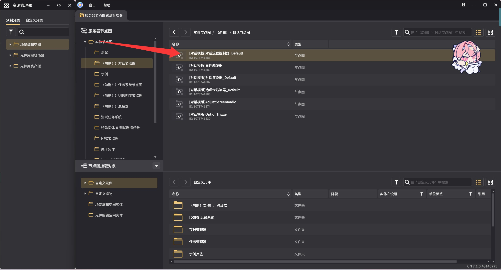

# v6.4（月之五）-定时器无法正常关闭

## 现象

在v6.4（月之五）及之前的版本中，存在对话结束无法正常关闭自动下一句话定时器的问题，表现为若提前关闭对话，会导致莫名重新推进对话。该问题在演出模版2.0中不存在

## 修复方法

进入下图节点图「[对话模板]对话流程控制器_Default」中

来到最上方这里

我们添加一个终止定时器，目标实体为自身实体，定时器名称为「DialogueAutoNext」

即可完成修复