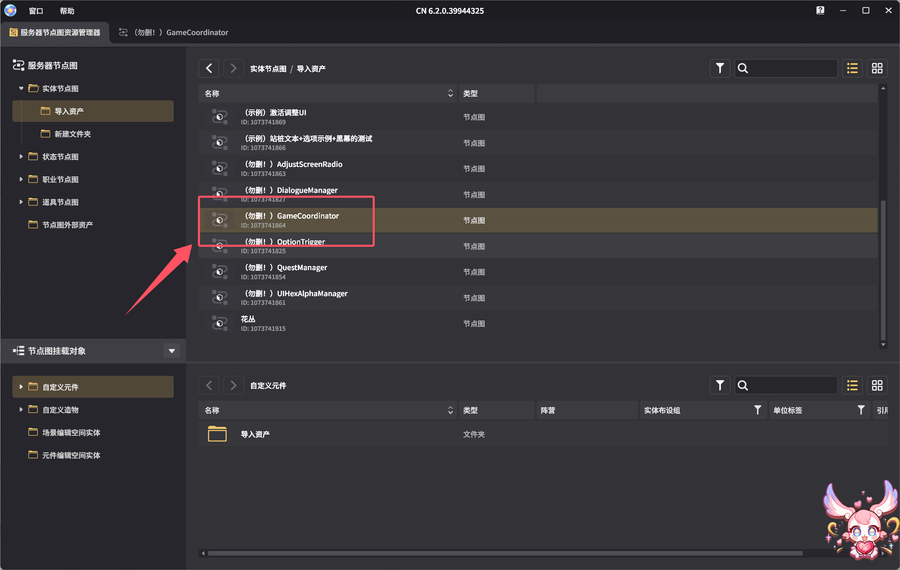
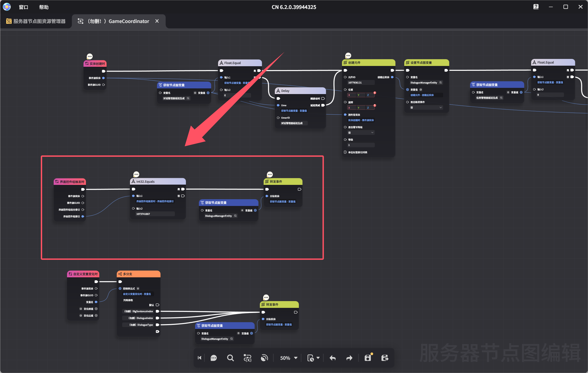
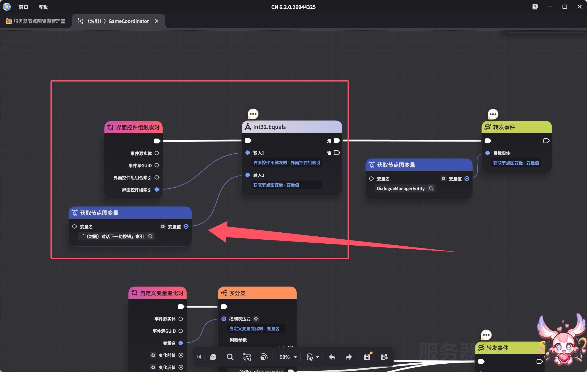

# 更新日志

## 2026.10. v2.1（v1.0.4）

### Bug修复

- 修复镜头在低帧情况下无法正常切换的Bug

- 修复传送导致的对话卡死问题（覆盖更新只能修复部分，仅2.1及以上版本支持重建，2.0无法重建，2.0版本需避免使用传送）（因此2.1版本将删除原先用来制作断线重连的玩家断线重连检测，转而使用一个通用客户端容器来监听断线重连事件）
- 修复实体键值字典变量设置错误问题【来自：冰镇糯米糕】
- 修复查看任务的按钮不会在对话中自动隐藏的问题

### 调整

- 负载优化-超出范围不运行默认关闭
- 关闭了大多实体的远距离负载优化【来自：冰镇糯米糕】
- 场景范围将设置成默认1000x1000x1000
- ~~需要给技能加一个末尾终止【来自：冰镇糯米糕】~~ 设置Clip是否需要拖尾属性
- 对话模版编辑器中实体的实体查询更名为实体注册表键名【来自：冰镇糯米糕】

### 内容添加

- 增加对经典模式的支持，但经典模式中不支持任何需要获得玩家镜头数据的操作

- 新增了更多技能动画模组，特别的，坐下的特殊动作模组会在动作播放完后接上100s的坐下-持续动画与坐下后摇动作

- 调整了对话编辑器，添加了版本的设置要求

- 在复合节点中添加版本的提示
- 公共事件添加玩家自动转向对话实体【来自：她曾梦见的晴空】
- 玩家限位添加禁止冲刺状态【来自：冰镇糯米糕】

## 2026.10.27 v2.0（v1.0.3.1）

### Bug修复

- 修复了移动端无法按下自动播放、历史对话、隐藏UI的Bug【来自：她曾梦见的晴空】
- 修复历史对话页面UI左上角页面文字会在不同比例屏幕下消失的问题【来自：她曾梦见的晴空】

### 调整

- 调整了移动端的下一句对话按钮大小，现在玩家可以在对话中点击到退出游戏按键

## 2026.10.18 v2.0（v1.0.3）

- 修复元件会被技能锁定的问题【来自：冰镇糯米糕】

## 2026.10.18 v2.0（v1.0.2）

- v2.0震撼发布，模版更新了大量内容，重写了几乎所有的逻辑

-  1.抛弃以往的对话系统，使用全新的演出系统播放剧情，以时间轴的方式配置演出
-  2.同时编辑将使用外部网页编辑器编辑。编辑器链接：https://tool.xiaomol444.xyz/DSFGStudio
-  3.依附于演出的，还有另一个功能更新是运镜功能。利用运动器叠加的原理，将镜头的机位与视点分离成两个实体控制，在特定情况下能使运镜变得更加理想。运动器叠加方法最先由小草提出，因此沫沫要给它冠名「小草运动器叠加法」。若未来有机会会单独介绍这个方法以及应用。运动器叠加属于千星「特色」，鉴于官方应该没有特意修复这个机制，因此将它公开出来，给大家尝试这个功能。（追述：如果大家玩过晓艺的后逝4，会发现里面的柯布骨骼移动很自然，同样也是利用了这个机制）
-  4.依附于演出的，除了旧版的实体自定义事件逻辑，新增了公共事件逻辑，可以执行一些常用并且可预设的行为，如「1.玩家播放技能动画、2.玩家传送、3.玩家移动到指定位置、4.播放简单黑幕、5.锁定并播放BGM、6.解锁BGM、7.演出注目镜头、8.重置镜头、9.触发实体朝向」
-  5.任务系统，具有与原神本体大部分相似的功能，例如章节、直属任务、地区显示、追踪显示，任务预览页面，以隐藏任务驱动主任务，并通过单位状态编辑任务的逻辑。在编辑器内可设置任务的流程，一个任务可以设置多个后续任务，可以设置一个失败回溯任务。任务追踪面板设计并不够完善，毕竟脚本的替换足够方便，节点图的逻辑应该是稳定的，之后如果有更新说明可以直接更新掉脚本
-  6.场景管理。场景管理仿照大世界，拥有「世界」、「一级区域」与「二级区域」的概念。世界与世界之间可以建立关联点，任务系统依附于场景管理，需要通过场景配置获取任务追踪提示。可使用节点图切换玩家的二级区域，同时也有单独的事件节点接受玩家切换区域并执行自定义逻辑 6.1.在场景管理下存在一个游戏数据状态的东西，储存着长度为100的整数列表，用于存档功能，使用二进制数来管理场上实体的值。鉴于是一个全局的概念因此丢到了场景管理模块下
-  7.存档，实现了简易的存档功能，接入了任务的存档（至多为20个接取的任务与进度值），6.1提及的游戏数据状态，以及至多20种背包道具，5种货币。若需要可自行修改节点。同时网页也提供游戏数据状态二进制预览页面，也支持将存档导出为gia后供网页读取预览二进制数
-  8.调试功能，具有一个简易的调试功能，在玩家身上的DevTools节点图中，将DebugMode设置为是即可在「试玩」时开启调试页面，调试页面可自行添加各种调试逻辑，或者Debug内容。除试玩游玩模式外会自动关闭调试模式
-  9.扩展样式，暂时没写。但大部分能自行接入的地方，都留下了sample.lua可以参考接口，对话的DialogRoot的行为也相对稳定，可以修改对话工具栏或者历史页面行为。 
- 另：客户端容器内的「按键屏蔽功能」似乎存在功能缺失的问题，在联系客服后似乎确认了这个问题，因此可能等补丁更新后我再重新检查一下按键适配的问题

## 2026.5.14

 - 修复了启用「DialogueAutoNext」定时器后重复开启对话遗漏关闭定时的Bug
 - 修复了执行节点图事件顺序异常问题（正常表现为先执行了节点图事件再为对话索引+1）

## 2026.1.28
 - 更新了超限模式-元件版本地图，优化了导入步骤

## 2026.1.21（仅经典模式+超限模式地图版）
 - 修复了强制关闭UI失败的问题

## 2026.1.14 V0.1.15 （仅经典模式+超限模式地图版）
 - 更新了经典模式
 - 将显示UI部分解耦出来
 - 把节点图事件触发的字典改成整数对应字符串列表【来自：理性与智慧】
 - 跳转对话新增自定义跳转类型
 - 调整了限位盒的厚度，使得运镜更难跳出【来自：Aplance_Sky】
 - 接取任务后将立即刷新任务距离

## 2025.12.5 v0.1.10.11
 - 修复了潜在的透明度闪烁问题

## 2025.12.3 v0.1.10.10
 - 修复了元件版调整Gamecoordinator节点图的按键索引后仍然无法正常使用下一句话按钮的问题
	::: details 手动修复
	1.在节点图中找到`（勿删！）Gamecoordinator`
	
	
	2.双击进入后，注意到红框这里的`界面控件触发时`，后面的`Int32.Equals复合节点`
		
		
	3.拉出一个获取节点图变量，小齿轮类型设置成整数（或者直接从节点图变量处拉出来获取节点图变量），节点图变量名设置成`「（勿删）对话下一句按钮」索引`即可
	
	
	:::
 - 修复了`（勿删！）Gamecoordinator`节点图创建管理器时可能会出现的飞线问题

## 2025.11.25 v0.1.10.9
 - 更新了运镜功能